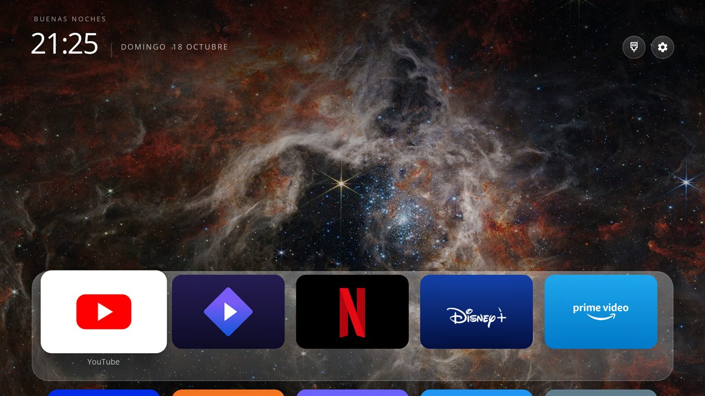

# CleanTV Launcher

*[Versión en español](README.md)*

A clean home screen for Android TV boxes with **three switchable themes**, wallpapers downloaded on demand, and no ads,
accounts or tracking. The interface follows the TV's language (Spanish or English).

> **Based on other people's work.** A fork of [itsmeterrylin/fire-tv-cleanup](https://github.com/itsmeterrylin/fire-tv-cleanup),
> itself a fork of [Gathin23/tv-vibehack](https://github.com/Gathin23/tv-vibehack). The launcher, the cleanup tools and the
> original idea come from them (MIT licence). See the [Spanish README](README.md#qué-cambió-este-fork) for what this fork
> changed.

| Dock | Circles | Tiles |
|---|---|---|
|  |  |  |

## Themes

The layouts are **inspired by** well-known TV home screens; they are not copies and do not use their names or marks.

- **Dock**: up to 8 magnified icons at the bottom, with a name tooltip and a glow in the app's colour; press Down for the
  rest as cards. *Inspired by the macOS dock.*
- **Circles**: one row of round icons hanging from the bottom, scrolling sideways, with the focused app's name as a big
  title. *Inspired by the Google TV home screen.*
- **Tiles**: wide tiles on a translucent plate, the focused one grows without leaving the plate, the next row peeks in below.
  *Inspired by the tvOS home screen.*

The header (greeting, clock, date, connection icon and Settings) is the same in every theme. The connection icon shows
Ethernet, Wi-Fi (with signal bars) or either one crossed out when there is no internet. Settings opens a panel with
**Theme**, **Wallpaper** and **Android settings** buttons.

## Install

JDK 17, the Android SDK (platform 34, build-tools 34.0.0), and the TV on the same network with debugging on:

```bash
python3 -m venv tools/venv && tools/venv/bin/pip install -r tools/requirements.txt
TV_HOST=192.168.1.50 launcher/build-and-install.sh
```

The stock launcher is left alone unless you add `DISABLE_STOCK=1`. Gradle could not be run on the author's PC; the APK was
built with the Android SDK tools and installed with `adb install`. Tested only on a ZTE B866V2 (Android 9). Fire TV is
not supported by this fork.

## Licence

MIT, see [`LICENSE`](LICENSE): © 2026 Gathin and © 2026 Nacho (changes in this fork). Fonts: SIL OFL. Credits in
[`CREDITS.md`](CREDITS.md). Brand names and logos belong to their owners.