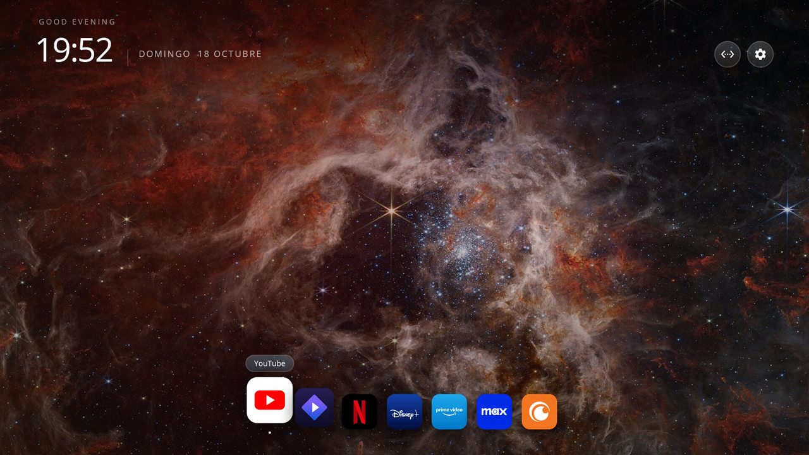
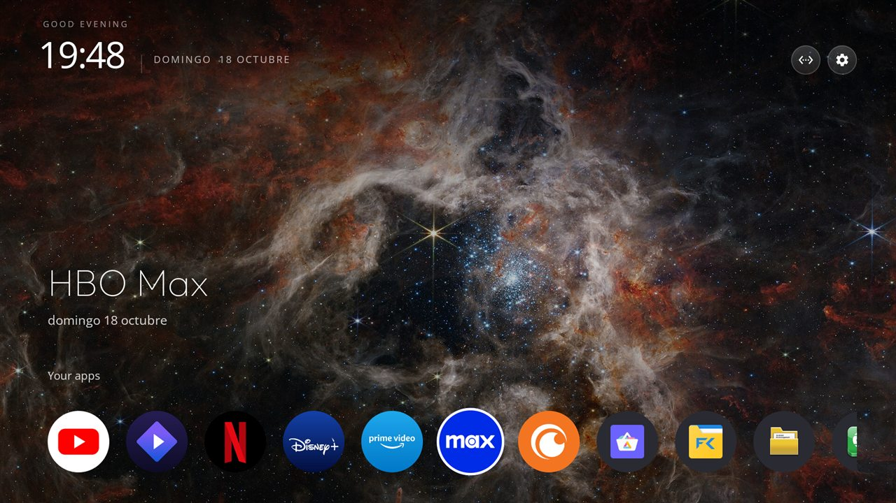
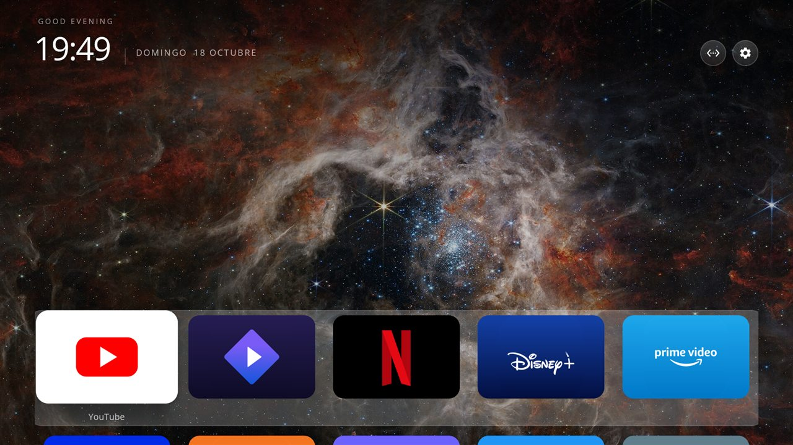
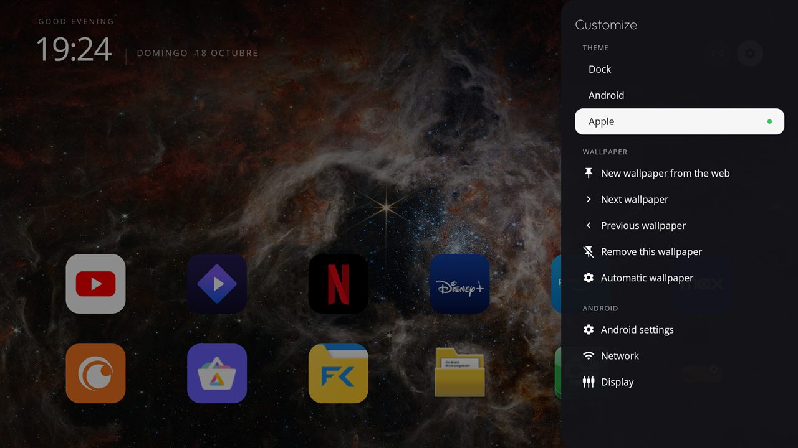

# CleanTV Launcher

A clean home screen for Android TV boxes, with three themes you can switch between: a **Dock** (macOS
style), **Android** (Google TV style) and **Apple** (tvOS style). Wallpapers are downloaded on demand,
apps can be pinned and reordered from the remote, and there are no ads, no accounts and no tracking.

> **Based on other people's work.** This is a fork of
> [itsmeterrylin/fire-tv-cleanup](https://github.com/itsmeterrylin/fire-tv-cleanup), which is itself a fork of
> [Gathin23/tv-vibehack](https://github.com/Gathin23/tv-vibehack). The launcher, the debloat tools and the
> original idea come from them (MIT licence, see [Licence](#licence)). What this fork changed is listed
> [below](#what-this-fork-changed).

| Dock | Android | Apple |
|---|---|---|
|  |  |  |

Screenshots taken on a ZTE B866V2 (Android 9). The wallpaper is a NASA/ESA/CSA image.

## The three themes

| Theme | What you get |
|---|---|
| **Dock** | A dock of up to 8 magnified icons at the bottom, with a name tooltip and a soft glow in the colour of the focused app. Press Down for the rest of your apps as banner cards. |
| **Android** | One row of round icons hanging from the bottom, a big title with the focused app's name, the date and "Your apps", like Google TV. The row scrolls sideways. |
| **Apple** | Wide tiles on a translucent shelf, the focused one grows and shows its name, the next row peeks in below, like tvOS. |

The header (greeting, clock, date, connection and Settings buttons) is the same in every theme; only the way
the apps are shown changes.

## The Settings panel

The Settings button opens a panel on the right edge:

- **Theme**: Dock, Android or Apple.
- **Wallpaper**: download a new one from the web, step through the ones you have, remove the current one, or go
  back to the time-of-day photos.
- **Android**: the system settings, network, display and sound screens, and the TV inputs when the box has any.



## Using it

- **Pin an app:** hold OK (or press Menu) on an app and choose **Pin to Dock** (in the Android and Apple themes
  it moves the app to the start of the list).
- **Reorder the dock:** hold OK on a dock app, choose **Move**, use Left and Right, press OK when done.
  Only dock apps can be moved; the rest are alphabetical, which is what makes pinning meaningful.
- **Some boxes grab the Menu key** for their own dialog. Hold OK instead.
- Nothing is animated in the grid; the dock keeps its magnification, tooltip and glow.

## Wallpapers

Nothing is bundled except the original time-of-day photos. [`assets/wallpapers.json`](launcher/app/src/main/assets/wallpapers.json)
is a list of links to freely licensed pictures on [Wikimedia Commons](https://commons.wikimedia.org) (CC0, public
domain, CC BY, CC BY-SA). **New wallpaper from the web** downloads one, crops it to 1920×1080 and keeps it in the
launcher's private storage together with its author and licence. Rebuild the list with
[`tools/make_wallpaper_catalog.py`](tools/make_wallpaper_catalog.py), or add your own list with
`wallpaper_catalog_url` in [`config.xml`](launcher/app/src/main/res/values/config.xml) (a JSON array of
`{"title", "credit", "url"}`). The launcher needs the `INTERNET` permission for this and nothing else.

## Install

You need JDK 17 and the Android SDK (platform 34, build-tools 34.0.0), and the TV on the same network with
USB / network debugging on (Settings → Device Preferences → About → press OK on **Build** seven times, then
Developer options → USB debugging).

```bash
python3 -m venv tools/venv && tools/venv/bin/pip install -r tools/requirements.txt
TV_HOST=192.168.1.50 launcher/build-and-install.sh      # your TV's IP
```

That builds the APK, installs it and sets it as the default home. The stock launcher is **not** touched unless you add `DISABLE_STOCK=1` (install first, disable second, or Home lands on a factory test app). To go back, uninstall it or choose the other launcher when Android asks.

> The script uses Gradle, which this fork could not run on its author's Windows PC (a Java NIO problem there). The APK was built directly with the Android SDK tools (`aapt2`, `javac`, `d8`, `apksigner`) and installed with `adb install`, which is the path that was tested.

The application id is still `com.gathin.tvhome`, as in the original. It is internal, and keeping it means
settings survive an update.

## Configuration

[`launcher/app/src/main/res/values/config.xml`](launcher/app/src/main/res/values/config.xml):

| Key | What it does |
|---|---|
| `dock_apps` | The starting dock, in order. After that you edit it on the TV. |
| `hidden_apps` | Packages never shown. |
| `live_tv_package` | The TV's tuner app, offered in the Inputs menu. Empty to omit. |
| `columns`, `dock_max`, `dock_slots` | Cards per row, most apps in the dock, and how close the dock icons sit. |
| `wallpaper_catalog_url` | Optional extra list of wallpapers. |

To put your name in the greeting, add `tvhome.userName=Alex` to `launcher/local.properties`.

### App icons

The dock and the Apple theme use square brand tiles (Netflix, YouTube, Prime Video, Disney+ and more). They are
trademarked logos, so they are **not in the repo**: [`tools/make_dock_icons.py`](tools/make_dock_icons.py) draws
them on your machine (needs Pillow, and downloads the marks once from the
[Dashboard Icons](https://github.com/homarr-labs/dashboard-icons) pack). Without them every app simply shows its own icon.

## What this fork changed

Compared with [itsmeterrylin/fire-tv-cleanup](https://github.com/itsmeterrylin/fire-tv-cleanup):

- Three switchable themes (Dock, Android, Apple) and a Settings panel to choose them.
- Wallpapers downloaded on demand from a Wikimedia Commons catalog, instead of a fixed set.
- A bigger dock (up to 8 apps, spacing configurable), with icon-only tiles and no ring around them, and an
  icon set for more apps (Disney+, Crunchyroll, Stremio, Max, Kodi, Spotify, Plex and others).
- Banner cards from each app's own TV banner for the apps below the dock.
- Reordering (Move) for dock apps, no bounce or entrance animations in the grid.
- A header that never changes between themes; the top bar is reduced to the connection and Settings buttons.
- The Fire TV Home-redirect accessibility service and the `WRITE_SECURE_SETTINGS` permission were **removed**: the
  launcher is for Android TV boxes, and it no longer asks for either.
- Grid navigation fixes (the original grid drifted a few pixels with every move).

Tested only on a ZTE B866V2 (Android 9, 32-bit ARM, 2 GB RAM). **Fire TV is no longer supported by this fork**,
and Samsung Tizen and LG webOS never were.

## Debloat toolkit (from the original project)

These parts are inherited, not changed here, and have not been re-tested by this fork:

| Path | What it is |
|---|---|
| [`PROMPT.md`](PROMPT.md) | A prompt for a coding assistant to debloat and set up a TV over ADB. |
| [`tools/tv.py`](tools/tv.py), [`tools/b64push.py`](tools/b64push.py) | A pure-Python ADB client and a chunked file upload. |
| [`tools/disable.sh`](tools/disable.sh), [`tools/restore.sh`](tools/restore.sh) | Apply or undo a debloat list. Packages are disabled, never uninstalled. |
| [`examples/`](examples/) | Per-TV debloat lists. See [CONTRIBUTING.md](CONTRIBUTING.md) to add yours. |

## Licence

MIT, see [`LICENSE`](LICENSE): © 2026 Gathin (original work) and © 2026 Nacho (changes in this fork). The Outfit
and Open Sans typefaces are under the SIL Open Font License, see `launcher/FONT-LICENSE-OFL.txt`. Photo and
asset credits are in [`CREDITS.md`](CREDITS.md). Brand names and logos belong to their owners.
