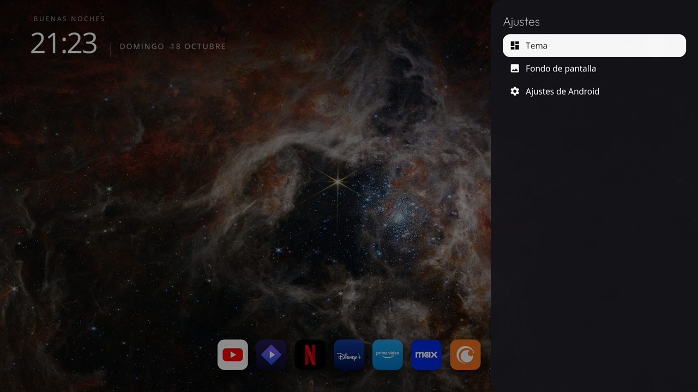

# CleanTV Launcher

*[English version](README.en.md)*

Una pantalla de inicio limpia para TV boxes con Android TV, con **tres temas** intercambiables, fondos de pantalla que se
descargan cuando los pedís y sin anuncios, cuentas ni rastreo. Se adapta al idioma del TV (español o inglés).

> **Basado en el trabajo de otras personas.** Es un fork de
> [itsmeterrylin/fire-tv-cleanup](https://github.com/itsmeterrylin/fire-tv-cleanup), que a su vez es un fork de
> [Gathin23/tv-vibehack](https://github.com/Gathin23/tv-vibehack). El launcher, las herramientas de limpieza y la idea
> original son de ellos (licencia MIT, ver [Licencia](#licencia)). Lo que cambió este fork está
> [más abajo](#qué-cambió-este-fork).

| Dock | Círculos | Mosaicos |
|---|---|---|
|  |  |  |

Capturas de un ZTE B866V2 (Android 9). El fondo es una imagen de NASA/ESA/CSA.

## Los tres temas

Los diseños están **inspirados** en pantallas de inicio conocidas, pero no son copias ni usan sus nombres ni sus marcas.

| Tema | Qué muestra | Inspirado en |
|---|---|---|
| **Dock** | Un dock de hasta 8 íconos que crecen al enfocarlos, con el nombre arriba y un brillo del color de la app. Con ↓ aparecen las demás apps como tarjetas. | El dock de macOS |
| **Círculos** | Una fila de íconos redondos abajo que se desplaza hacia el costado, con el nombre de la app enfocada en grande y la fecha. | La pantalla de inicio de Google TV |
| **Mosaicos** | Mosaicos anchos sobre una bandeja translúcida; el enfocado crece y muestra su nombre, y la fila siguiente asoma abajo. | La pantalla de inicio de tvOS |

El encabezado (saludo, hora, fecha, conexión y Ajustes) es el mismo en todos los temas; solo cambia cómo se muestran las apps.

## Encabezado

- **Conexión:** un solo ícono. Ethernet si está por cable, Wi-Fi (con barras de señal) si está por Wi-Fi, y el mismo
  ícono tachado si no hay internet o no hay red.
- **Ajustes:** abre un panel a la derecha con tres botones: **Tema**, **Fondo de pantalla** y **Ajustes de Android**.
  Tema y Fondo abren su propia pantalla dentro del panel (con *Volver*); Ajustes de Android abre directamente los
  ajustes del sistema. Si la caja tiene entradas HDMI o sintonizador, aparece también **Entradas**.



## Cómo se usa

- **Fijar una app:** mantené OK (o apretá Menú) sobre la app y elegí *Fijar en el dock* (en Círculos y Mosaicos pasa
  al principio de la lista).
- **Reordenar el dock:** mantené OK sobre una app del dock, elegí *Mover*, usá ← y →, y OK al terminar. Solo se mueven
  las apps del dock; el resto va en orden alfabético, y por eso fijar tiene sentido.
- Algunas cajas capturan la tecla Menú para su propio diálogo; en ese caso mantené OK.
- La grilla no tiene animaciones; el dock conserva el crecimiento, el nombre y el brillo.

## Fondos de pantalla

No se incluye ninguno aparte de las fotos originales según la hora. [`wallpapers.json`](launcher/app/src/main/assets/wallpapers.json)
es una lista de enlaces a imágenes de libre uso de [Wikimedia Commons](https://commons.wikimedia.org) (CC0, dominio
público, CC BY, CC BY-SA). *Nuevo fondo de la web* descarga una, la recorta a 1920×1080 y la guarda en el almacenamiento
privado del launcher junto con su autor y licencia. Podés regenerar la lista con
[`tools/make_wallpaper_catalog.py`](tools/make_wallpaper_catalog.py) o sumar la tuya con `wallpaper_catalog_url` en
[`config.xml`](launcher/app/src/main/res/values/config.xml) (un JSON con `{"title", "credit", "url"}`). Es lo único
para lo que el launcher usa el permiso de internet.

## Instalación

Necesitás JDK 17 y el Android SDK (plataforma 34, build-tools 34.0.0), y el TV en la misma red con la depuración activada
(Ajustes → Preferencias del dispositivo → Acerca de → apretá OK siete veces en **Compilación**; después, Opciones de
desarrollador → Depuración USB).

```bash
python3 -m venv tools/venv && tools/venv/bin/pip install -r tools/requirements.txt
TV_HOST=192.168.1.50 launcher/build-and-install.sh      # la IP de tu TV
```

Compila el APK, lo instala y lo deja como inicio. El launcher de fábrica **no se toca** salvo que agregues
`DISABLE_STOCK=1` (primero instalá, después deshabilitá, o Inicio cae en una app de pruebas de fábrica). Para volver,
desinstalá el launcher o elegí el otro cuando Android pregunte.

> El script usa Gradle, que este fork no pudo ejecutar en la PC de su autor (un problema de Java NIO). El APK se armó
> directamente con las herramientas del SDK (`aapt2`, `javac`, `d8`, `apksigner`) y se instaló con `adb install`; ese es
> el camino que se probó.

El id de la aplicación sigue siendo `com.gathin.tvhome`, como en el original. Es interno y mantenerlo conserva tus ajustes
al actualizar.

## Configuración

[`launcher/app/src/main/res/values/config.xml`](launcher/app/src/main/res/values/config.xml):

| Clave | Para qué sirve |
|---|---|
| `dock_apps` | El dock inicial, en orden. Después se edita desde el TV. |
| `hidden_apps` | Paquetes que nunca se muestran. |
| `live_tv_package` | La app del sintonizador, para el menú Entradas. Vacío para omitirla. |
| `columns`, `dock_max`, `dock_slots` | Tarjetas por fila, máximo de apps en el dock y qué tan juntos van sus íconos. |
| `wallpaper_catalog_url` | Lista opcional de fondos propios. |

Para poner tu nombre en el saludo, agregá `tvhome.userName=Alex` a `launcher/local.properties`.

### Íconos de las apps

El dock y los Mosaicos usan fichas cuadradas con la marca de cada app (Netflix, YouTube, Prime Video, Disney+ y más).
Son logos registrados, así que **no están en el repo**: [`tools/make_dock_icons.py`](tools/make_dock_icons.py) los dibuja
en tu máquina (necesita Pillow y baja las marcas una vez del paquete
[Dashboard Icons](https://github.com/homarr-labs/dashboard-icons)). Sin ellos, cada app muestra su propio ícono.

## Qué cambió este fork

Respecto de [itsmeterrylin/fire-tv-cleanup](https://github.com/itsmeterrylin/fire-tv-cleanup):

- Tres temas intercambiables (Dock, Círculos y Mosaicos) y un panel de Ajustes para elegirlos.
- Fondos descargados bajo demanda desde un catálogo de Wikimedia Commons, en lugar de un conjunto fijo.
- Un dock más grande (hasta 8 apps, con separación configurable), con íconos sin recuadro, y más íconos de marca
  (Disney+, Crunchyroll, Stremio, Max, Kodi, Spotify, Plex y otros).
- Tarjetas con el banner propio de cada app para las que no están en el dock.
- Mover apps del dock, y sin rebotes ni animaciones de entrada en la grilla.
- Un encabezado que no cambia entre temas, con un único ícono de conexión (Ethernet, Wi-Fi o tachado) y Ajustes.
- Interfaz en español e inglés según el idioma del TV.
- Se **quitaron** el servicio de accesibilidad que redirigía Inicio en Fire TV y el permiso `WRITE_SECURE_SETTINGS`: el
  launcher es para cajas con Android TV y ya no pide ninguno de los dos.
- Correcciones de navegación en la grilla (la original se corría unos píxeles con cada movimiento).

Probado solo en un ZTE B866V2 (Android 9, ARM de 32 bits, 2 GB de RAM). **Fire TV ya no está soportado por este fork**, y
Samsung Tizen y LG webOS nunca lo estuvieron.

## Herramientas de limpieza (del proyecto original)

Estas partes se heredan sin cambios y este fork no las volvió a probar:

| Ruta | Qué es |
|---|---|
| [`PROMPT.md`](PROMPT.md) | Un prompt para que un asistente de código limpie y configure un TV por ADB. |
| [`tools/tv.py`](tools/tv.py), [`tools/b64push.py`](tools/b64push.py) | Un cliente ADB en Python puro y una subida de archivos por partes. |
| [`tools/disable.sh`](tools/disable.sh), [`tools/restore.sh`](tools/restore.sh) | Aplican o deshacen una lista de apps a deshabilitar. Los paquetes se deshabilitan, nunca se desinstalan. |
| [`examples/`](examples/) | Listas por modelo de TV. Ver [CONTRIBUTING.md](CONTRIBUTING.md) para sumar la tuya. |

## Licencia

MIT, ver [`LICENSE`](LICENSE): © 2026 Gathin (obra original) y © 2026 Nacho (cambios de este fork). Las tipografías Outfit y
Open Sans están bajo la SIL Open Font License, ver `launcher/FONT-LICENSE-OFL.txt`. Los créditos de fotos y recursos están en
[`CREDITS.md`](CREDITS.md). Los nombres y logos de marcas pertenecen a sus dueños.